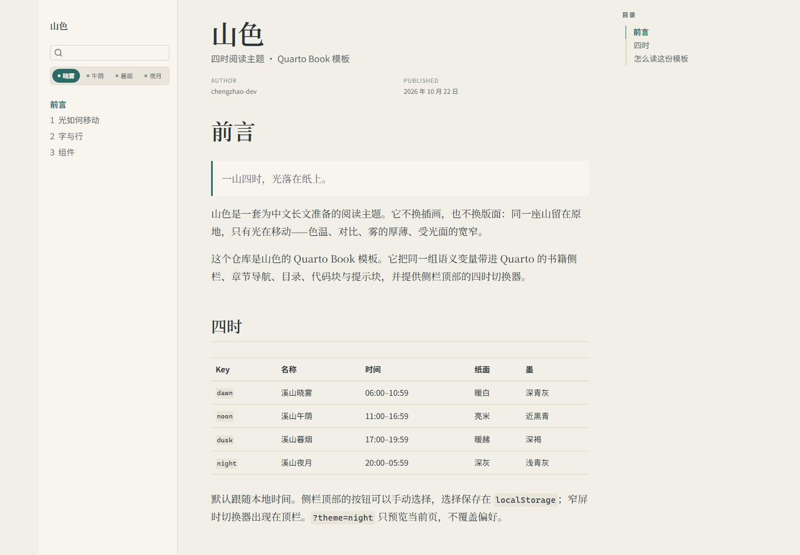
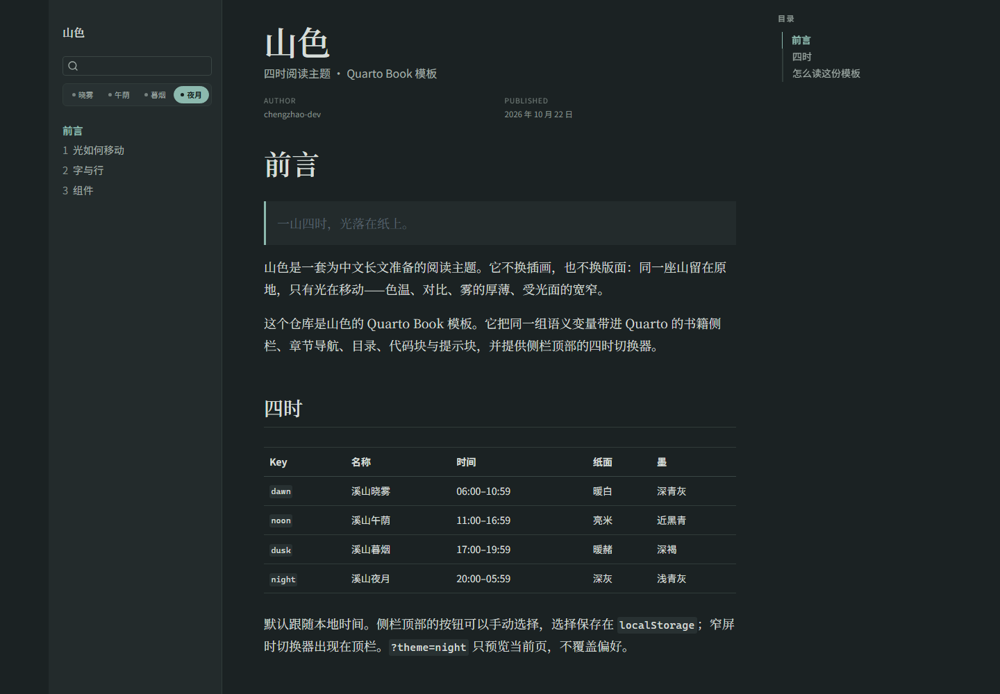
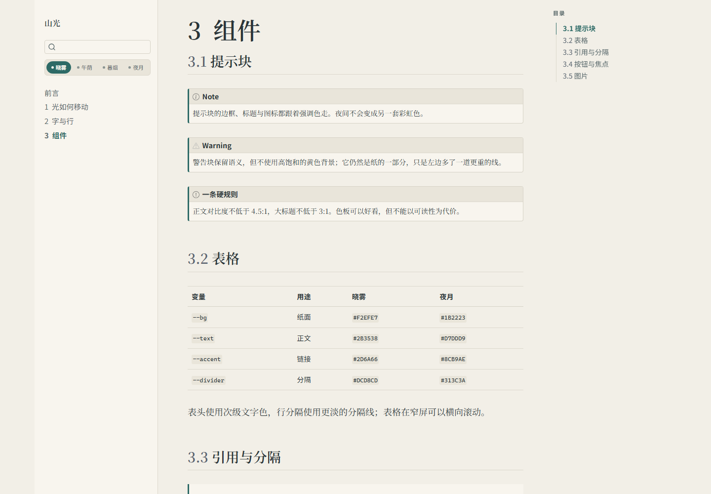
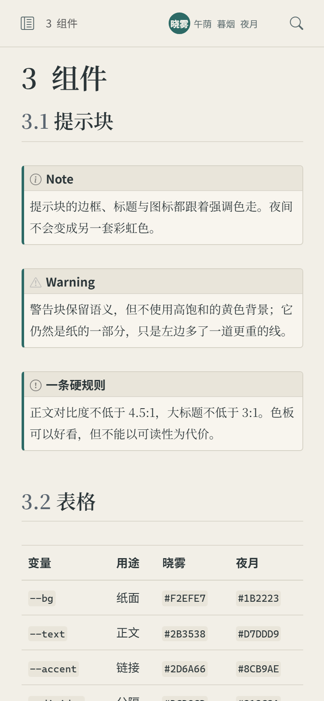

# 山色 · Hill Light for Quarto Book

一套为中文长文准备的四时阅读主题，打包成 Quarto Book 扩展。同一座山留在原地，只让光移动：晓雾、午荫、暮烟、夜月共用一套语义变量，切换时不重建 DOM，也不换版式。



## 特点

- **四时自动切换**：按本地时间选择晓雾（06:00–10:59）、午荫（11:00–16:59）、暮烟（17:00–19:59）、夜月（20:00–05:59）。
- **手动选择优先**：侧栏顶部（窄屏为顶栏）的四枚按钮可随时切换，选择写入 `localStorage`，跨页保持。
- **单页预览**：`?theme=night&preview=1` 强制预览当前页，不覆盖已保存的偏好。
- **完整的 Quarto 桥接**：正文、侧栏、目录、搜索、提示块、表格、代码块、页导航、页脚都接同一组变量，夜间不会留下 Bootstrap 的蓝色或浅灰底。
- **无构建依赖**：扩展只包含一个 SCSS、两段内联 HTML（首屏脚本与控制器），不引入额外的 JS 包。
- **可读性优先**：正文对比度 ≥ 4.5:1，夜间背景不是纯黑，正文不是纯白；尊重 `prefers-reduced-motion`。

## 安装

要求 Quarto **1.4 或更高**（开发和验证使用 1.10.19）。

1. 把本仓库的 `_extensions/hill-light/` 整个目录复制到你的书项目根目录。
2. 在 `_quarto.yml` 中启用扩展格式：

```yaml
project:
  type: book

book:
  title: "你的书名"
  chapters:
    - index.qmd

format:
  hill-light-html:
    toc: true
    number-sections: true
```

也可以用 `format: hill-light-html` 的简写。扩展格式名固定为 `hill-light-html`；只写 `theme: [hill-light]` 不会被 Quarto 解析为扩展。

3. 预览：

```bash
quarto preview
```

## 主题行为

| 主题 | 名称 | 自动时段 | 纸面 | 墨 |
| --- | --- | --- | --- | --- |
| `dawn` | 溪山晓雾 | 06:00–10:59 | 暖白 | 深青灰 |
| `noon` | 溪山午荫 | 11:00–16:59 | 亮米 | 近黑青 |
| `dusk` | 溪山暮烟 | 17:00–19:59 | 暖赭 | 深褐 |
| `night` | 溪山夜月 | 20:00–05:59 | 深灰 | 浅青灰 |

- 首次访问按本地时间自动选择，不写入存储。
- 点击切换器后写入 `localStorage` 的 `hill-light-theme`，之后跨页保持。
- `?theme=dawn|noon|dusk|night&preview=1` 是强制预览，只对当前页面生效，不覆盖已保存偏好；没有保存偏好时省略 `preview=1` 也能生效。
- 没有 JavaScript 时，CSS 默认落在晓雾，正文仍然可读；切换器隐藏。

## 页面结构

- `index.qmd`：四时说明与模板入口。
- `chapters/light.qmd`：光如何移动、同一构图、代码块随主题变色。
- `chapters/type.qmd`：字号、字体、列表、脚注与行内代码。
- `chapters/components.qmd`：提示块、表格、引用、按钮与焦点、内联 SVG 山水。

## 自定义

所有颜色、字体与间距都在 `_extensions/hill-light/hill-light.scss` 顶部的四组变量里。改一处即可改整套书；不要在章节里写死颜色。

更完整的变量表、对比度数据与设计决策见 [hill-light-theme](https://github.com/hill-light/hill-light-theme) 的 `DESIGN.md`。

## 开发

```bash
quarto render
python -m http.server 8766 --directory _book
```

`quarto render` 会重建 `_book/`。Windows 上如果预览服务器还占用 `_book/`，先停止服务器再渲染。

## 截图

| 晓雾 | 夜月 |
| --- | --- |
|  |  |

| 组件 | 移动端 |
| --- | --- |
|  |  |

## 相关仓库

- [hill-light-theme](https://github.com/hill-light/hill-light-theme)：设计规范、CSS 变量与静态演示站。
- [hill-light-quarto-website](https://github.com/hill-light/hill-light-quarto-website)：同一套主题的 Quarto Website 模板。

## 许可

MIT，见 [LICENSE](LICENSE)。
